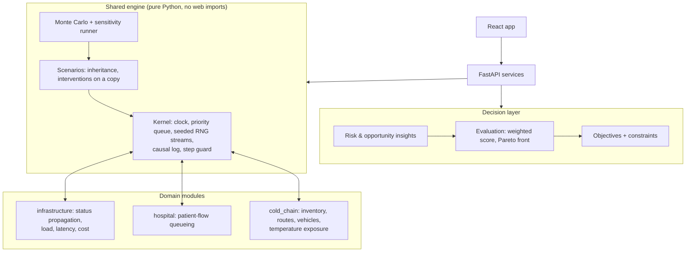

# Branchpoint v2: from failure simulator to decision platform

Goal: turn Branchpoint into an **Alternative Future Simulation & Decision
Intelligence Platform** with three domains (software infrastructure,
hospital patient flow, cold-chain logistics) on one shared engine, without
losing anything that works today.

This file is the plan. Each phase ends with tests passing and a short
report (what changed, what was preserved, how to verify).

---

## 1. Audit: what exists today

| Area | Current state | Carries over? |
|---|---|---|
| Engine loop | `simulation/engine.py` `Simulator`: heap queue, clock, seeded RNG, causal log, START/END/EVALUATE items | Yes, the queue/clock/RNG/log become the shared **kernel** |
| Domain layer | `domains/base.py` `DomainRules` with two methods: `intrinsic_status`, `effective_status` | Only fits status propagation. Hospital and logistics need queues, resources and stock, so domains must own their whole model |
| Models | `Component` (type + free-form `attributes`), `Dependency` (fixed: type, group, delay), `Event` (fixed 4 types), `System` (has a `domain` field) | Components fit any entity. Dependencies and events need free-form `attributes` / `params`; event types must come from the domain |
| Scenarios | inheritance, overrides, interventions on a deep copy, seeds | Yes, unchanged |
| Metrics | fixed `Metrics` dataclass (availability, downtime, ...) | Must become per-domain metric definitions with units and a "better is lower/higher" direction |
| Monte Carlo | seeds `base + i`, aggregates hard-wired to downtime | Generalise to every metric of the domain |
| Database | 9 tables; metrics, snapshots, timelines already JSON | Mostly yes. Needs JSON `attributes` on dependencies, `params` on events, `parameters`/`objectives` on systems. No migrations yet, so add Alembic |
| API | 24 endpoints, Pydantic schemas with fixed metric fields | Keep all; add domain catalog, objectives, evaluation, sensitivity, insights |
| Frontend | landing, systems, design, scenarios (+ Monte Carlo), playback, compare; catalogs and metric columns hard-coded for infrastructure | Make catalogs and metric columns come from the domain catalog API; add futures dashboard and analysis |
| Tests | 71 backend, 17 frontend unit, 1 e2e browser test | All must keep passing; they are the safety net for the refactor |

Known limitations to fix along the way: no migrations, traffic does not
propagate downstream, infrastructure has no latency/utilisation/cost model,
Docker build unverified, not deployed.

---

## 2. Target architecture

### The kernel (shared)
`Kernel(until, seed)` owns time, the priority queue, the causal log and
random numbers. Domains schedule items with `kernel.at(time, kind, target,
data, cause)` and receive them in `handle(item)`. Every state change is
logged with the id of the log entry that caused it, so **every domain gets
the "why did this happen?" chain for free**.

Random numbers come in named **streams** (`kernel.stream("arrivals")`).
That gives *common random numbers*: two branches see the same patient
arrivals or the same demand unless a decision changes them, so differences
between futures come from the decisions, not from luck. The existing
`random.Random(seed)` stream for event sampling is kept exactly, so current
results do not change.

### A domain module
Each domain provides a `DomainSpec` plus a model class:

- **catalog**: entity types (with attribute fields, units, defaults),
  relationship types, event types (and whether they target an entity or a
  relationship), intervention types;
- **metric definitions**: key, label, unit, direction (lower/higher is
  better), and which one is the default "risk" metric for Monte Carlo;
- **model**: `setup`, `handle`, `finish -> Outcome`;
- **validation** and **insights** (bottlenecks, vulnerable entities).

`Outcome` = metrics dict + status timelines (optional) + numeric series
(queue length, occupancy, inventory over time) + causal log + skipped
events. The API and UI read the catalog, so adding a domain needs no new
screens.

### The 15 concepts from the brief

| Concept | Where it lives |
|---|---|
| Domain | `System.domain` + `DomainSpec` |
| System | `System` (+ new `parameters`: system-wide variables such as arrival rate) |
| Entity | `Component` (type + domain attributes) |
| Relationship | `Dependency` (type + new free-form `attributes`: routing probability, travel time, cost) |
| State | kernel state + domain state, recorded as timelines and series |
| Variable | system `parameters` and entity attributes; changed by `set_attribute` / `set_parameter` interventions |
| Event | `Event` (domain event types; new `params`; may target a relationship) |
| Decision | a scenario's interventions (each with a cost and description) |
| Intervention | `Intervention` (generic + domain-specific types) |
| Constraint | objective with a limit (e.g. average wait at most 30 min, cost at most 5,000) |
| Objective | metric + direction + weight (+ optional limit), saved per system |
| Scenario | unchanged |
| Simulation run | unchanged (snapshots + seed, replayable) |
| Outcome | `Outcome` (metrics, series, timelines, log) |
| Explanation | causal log chain + evaluation explanations ("B is 30% cheaper but waits 12% longer") |

---

## 3. Domain models

### 3.1 Software infrastructure (existing, broadened)
Kept: status propagation through requires/optional/fallback groups with
delays. Added:
- **Load flow**: a dependency can forward a share of its source's traffic
  (`load_share`), so "traffic +300%" reaches the database.
- **Latency**: each component has a base latency; latency grows with
  utilisation (`base / (1 - utilisation)`, capped) and adds along the slowest
  required path from the entry point.
- **Utilisation** (peak load / capacity) and **infrastructure cost**
  (`cost_per_hour` per component x time + one-off intervention costs).
- New decisions: scale capacity, add server/replica, add cache, change
  dependency. New metric: failure probability (from Monte Carlo).

### 3.2 Hospital operations (new): discrete-event queueing
- **Entities**: arrival source (patients/hour, acuity mix), care units
  (emergency, diagnostics, wards, operating theatre) with *servers* (staff
  or rooms) and *beds*, service time (mean, distribution), cost per server-hour.
- **Relationships**: patient pathways with routing probabilities; a unit
  can *require* another unit (e.g. emergency needs diagnostics).
- **Process**: Poisson arrivals, first-come-first-served queues per unit,
  sampled service times, routing to the next unit, discharge. Patients who
  wait longer than a set limit are counted as delayed/unserved demand.
- **Events**: arrival surge, unit closure, staff shortage, equipment
  outage. **Decisions**: change staffing, beds, routing, schedules, add a unit.
- **Metrics**: average and p95 wait, throughput, bed and staff
  utilisation, operating cost, flow efficiency (treatment time / time in
  hospital), unserved demand.
- **Explicit assumptions**: synthetic data, simplified queueing, no
  clinical judgement. The UI states this on every hospital screen.

### 3.3 Cold-chain logistics (new): inventory and routing
- **Entities**: suppliers, warehouses (stock, capacity, refrigeration),
  distribution centres, destinations (daily demand), vehicle fleets
  (count, capacity, refrigerated).
- **Relationships**: routes with travel time, cost per trip and reliability.
- **Process** (time in hours): destinations order periodically; each order
  is served from the warehouse with stock that is best by the chosen
  routing policy, using **Dijkstra's shortest path** over routes (by time
  or by cost); a vehicle must be free; stock is replenished from suppliers
  when below a reorder point. Products have a maximum safe time outside
  refrigeration; refrigeration failures and delays accumulate exposure, and
  exposure beyond the limit marks units as spoiled.
- **Events**: route closure, vehicle breakdown, refrigeration failure,
  demand spike, delivery delay. **Decisions**: alternative routes or
  routing policy, inventory redistribution, extra storage, more vehicles,
  different schedules.
- **Metrics**: average delivery time, transport cost, fill rate
  (inventory availability), unfulfilled demand, spoiled units, temperature
  excursions, on-time rate, warehouse utilisation.
- **Explicit assumptions**: simulated operational risk from user-defined
  limits; not a prediction of product safety.

---

## 4. Decision layer
- **Objectives**: pick metrics, a direction comes from the domain, assign
  weights, optionally a limit (constraint). Saved per system.
- **Evaluation** over a set of runs or Monte Carlo batches:
  min-max normalise each metric across the compared futures, weighted
  score, constraint violations, and the **Pareto front** (futures that no
  other future beats on every objective). There is no single "best"
  unless the weights say so; the UI shows the trade-off explicitly.
- **Sensitivity analysis**: vary one variable (e.g. arrival rate x0.8 to
  x1.6) and chart each objective; a tornado chart ranks which assumptions
  move the result most.
- **Risk & opportunity insights** (each links to the entity, event or
  scenario it came from): most vulnerable entity (largest blast radius /
  most failures), biggest bottleneck (highest utilisation or longest
  queue), riskiest decision (worst p95), dominated futures and the
  alternative that beats them, assumption with the largest impact.
- **Suggestions (later)**: a small greedy search over candidate
  interventions that improves the weighted score, always shown as a new
  scenario the user can inspect, never applied silently.

---

## 5. Frontend
- **Landing**: "Explore alternative futures. Make better decisions.", the
  three domains, one example experiment each (loaded and run for real).
- **Projects**: new system with a domain picker; examples per domain;
  import/export; recent runs.
- **Designer**: palette, inspector fields and relationship types from the
  domain catalog. Same graph editor and JSON mode.
- **Scenario explorer**: the branching tree becomes a visual tree; events,
  decisions (interventions), variables and constraints per scenario.
- **Futures dashboard** (new tab): baseline vs alternatives, objective
  weights, ranked scores, Pareto chart, best/worst Monte Carlo outcomes,
  assumptions list.
- **Risk & opportunity panel**: clickable insights.
- **Compare**: metric columns from the domain catalog plus objectives.
- **Playback**: status colours plus numeric series charts (queue length,
  bed occupancy, inventory, deliveries in transit).

---

## 6. Phases

Status: **all eight phases are done.** The only item that needs you is creating the hosted service
(it needs your Render/Railway/Fly account; see [DEPLOY.md](DEPLOY.md)).

| # | Phase | Main deliverables | Tests |
|---|---|---|---|
| 1 | Audit and plan ✅ | this document | – |
| 2 | Generalise the engine ✅ | kernel + RNG streams; `DomainSpec` catalog; `Outcome` with metric dict; infrastructure moved onto the kernel with identical results; relationship `attributes`, event `params`, system `parameters`; Alembic migrations; `GET /api/domains` | all 71 existing tests unchanged + kernel, catalog and migration tests |
| 3 | Decision layer + broader infrastructure ✅ | objectives/constraints API, evaluation + Pareto, generic Monte Carlo aggregates, sensitivity, insights; infrastructure load flow, latency, utilisation, cost | hand-checkable Pareto/score cases; latency/load cases |
| 4 | Frontend evolution ✅ | catalog-driven designer and compare; futures dashboard; analysis panel; series charts in playback; landing copy | unit tests for new `lib/` logic; e2e extended |
| 5 | Hospital domain ✅ | model, catalog, example, assumptions panel | queueing checks against known results (M/M/1 average wait) |
| 6 | Cold-chain domain ✅ | model, Dijkstra routing, example | shortest path, stock and spoilage cases |
| 7 | Hardening ✅ | cross-domain tests, Postgres, performance on large synthetic systems | full suite + benchmarks |
| 8 | Deployment and polish ✅ | Dockerfile reads `PORT`/`DATABASE_URL`, health check, non-root user; `render.yaml`; CI building and smoke-testing the image; DEPLOY.md; screenshots; a recorded demo walkthrough | CI Docker smoke test (the live URL needs your account) |

### Decisions and trade-offs
- **One engine, domain-owned models** instead of forcing every domain
  into status propagation. The kernel is genuinely shared; each domain's
  rules stay readable and separately testable.
- **Free-form JSON attributes** for domain data rather than new fixed
  columns per domain, as the brief asks.
- **Alembic** for schema changes so existing databases keep their data.
- **Backwards compatibility**: existing API fields (e.g. `downtime_mean`)
  stay until the frontend no longer needs them.
- **Deployment target**: a container platform with managed PostgreSQL
  (Render, Railway or Fly.io). Creating the hosted service needs your
  account; everything else (config, health checks, docs) is prepared here.
