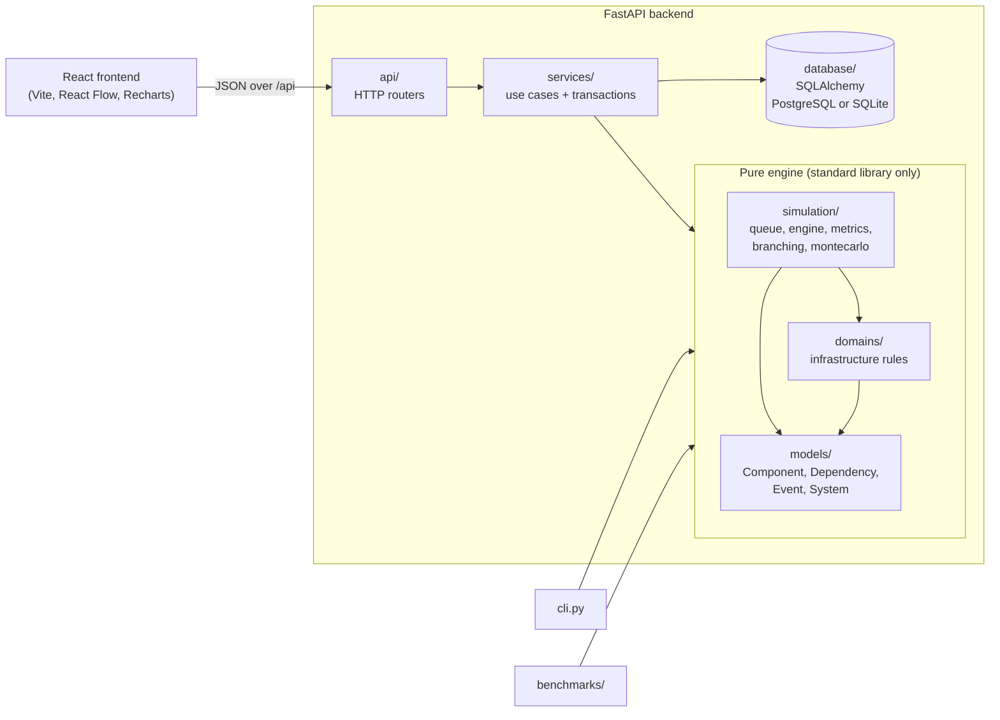
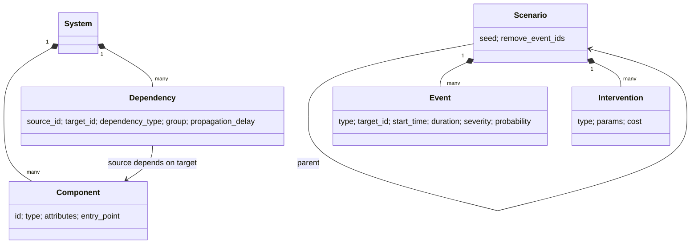
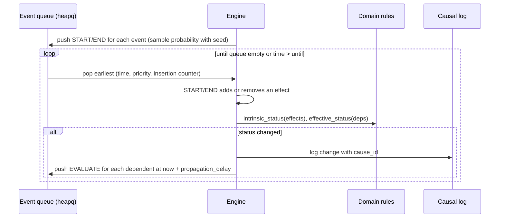

# Branchpoint architecture

This document explains how Branchpoint is put together: the layers, how a
simulation runs, how results are stored and reproduced, and the main design
decisions with their trade-offs. Read the README first for what the tool does.

## 1. The big picture



The arrows show which layer is allowed to import which. The rule that matters
most: **`simulation/`, `domains/` and `models/` never import FastAPI or
SQLAlchemy.** The engine runs the same from a Python script, the CLI, the
benchmarks or the API, and its tests need no database or server.

| Layer | Knows about | Does not know about |
|---|---|---|
| `models/` | what a component, dependency, event and system are; structural validation | time, rules, storage |
| `domains/` | what a status *means* for software infrastructure (failures, latency, load, groups) | time, queues, storage |
| `simulation/` | time, the event queue, effects, the causal log, metrics, branching, Monte Carlo | HTTP, SQL, what "infrastructure" means |
| `services/` | use cases: create, validate, run, replay, compare; database transactions | HTTP details |
| `api/` | HTTP: routes, status codes, request/response models | business rules |

Errors cross the layers in one direction. Services raise `NotFound`, `Conflict`
or `InvalidInput`; one handler in `main.py` turns them into 404, 409 and 422.

## 2. The domain model



- **Direction:** `source_id` depends on `target_id`. When the target breaks, the
  effect flows to the source. The engine therefore keeps two adjacency maps
  (`depends_on` and `dependents`) in `DependencyGraph`.
- **Groups** make redundancy work: dependencies on one source that share a
  `group` are interchangeable, so the source needs only one healthy member.
  A replica or fallback that is not in the same group as the primary has no effect.
- **Status** is an `IntEnum` (HEALTHY 0, DEGRADED 1, FAILED 2), so "the worse of
  two statuses" is simply `max()`.

## 3. How one simulation runs



1. Each event becomes a START item (and an END item if it has a duration).
   Events with `probability < 1` are sampled with `random.Random(seed)`, after
   sorting by `(start_time, id)` so the input order cannot change the result.
2. The queue orders items by `(time, priority, insertion counter)`. At equal
   times END comes before START before EVALUATE, and the counter breaks any
   remaining tie. Nothing depends on dictionary or hash order, so a run is
   fully deterministic.
3. Evaluating a component asks the domain rules for its own status (from its
   effects) and then its effective status (combined with its dependencies).
4. A change is logged with `cause_id` pointing at the log entry that caused it,
   and every dependent is scheduled for re-evaluation. That chain of pointers
   is what powers "why did this happen?" in the UI and `--explain` in the CLI.

A `max_steps` guard stops runs that oscillate (possible with cycles).

**Metrics** are computed afterwards from the status timelines, measured at the
entry-point components: availability, downtime, degraded time, affected
components, recovery time and intervention cost.

### The shared kernel and domain plug-ins

The loop above is split in two. `simulation/kernel.py` holds what every
domain needs: the clock, the priority queue, the seeded random generator,
named random streams, the causal log and the step guard. It knows nothing
about components or statuses. `Kernel.stream("arrivals")` returns a generator
seeded from `f"{seed}:arrivals"`, so a domain that draws arrivals and service
times from separate streams gets **common random numbers**: changing one
decision does not reshuffle unrelated random draws, which makes branch
comparisons fairer. Event sampling still uses `Random(seed)`, so every result
from before the split is unchanged (the tests and the Monte Carlo numbers
were checked to be identical).

A domain is a plug-in with two parts:

- a **catalog** (`domains/spec.py`, `DomainSpec`): its entity types and their
  fields, relationship types, event types, decision types, the metrics a run
  produces (with units and whether lower or higher is better), the metric
  Monte Carlo treats as risk, and the model's assumptions in plain words.
  `GET /api/domains` serves it so the frontend can build forms and comparison
  columns without hard-coding one domain;
- a **`Domain` class** whose `simulate()` runs the model on the kernel and
  returns an `Outcome` (metrics, causal log, status timelines, numeric time
  series). Software infrastructure is `InfrastructureDomain`, which wraps the
  existing `Simulator`.

`run_scenario`, Monte Carlo, the comparison table, the services and the API
only talk to this interface. Systems carry free-form `parameters`,
dependencies `attributes` and events `params`, so a new domain can store its
own data without schema changes; the `set_parameter` and
`set_dependency_attribute` decisions change them in a branch.

### Opt-in infrastructure modelling: load, latency, cost

Systems built before Phase 3 give exactly the same results, because each of
these only switches on when the data for it is present:

- **Load flow.** A dependency with a `load_share` attribute forwards that
  share of the caller's *extra* load (its load above its normal
  `current_load`) to the target, after every traffic change. Load is pushed
  callers-first (reverse topological order). The target's new load is logged
  as an event linked to its cause, so "why did the database degrade?" traces
  back through "load from callers +100" to the spike.
- **Latency.** With `latency` set on components, the end-to-end latency at the
  entry points is computed after the run from the status timelines: a
  component's own latency plus, for each dependency group, the latency of the
  member a request would use (healthiest, then fastest). Only components that
  are slow *themselves* (an event or overload, recorded in a separate
  "intrinsic" timeline) get the `degraded_latency_factor`; components degraded
  only because of a dependency inherit the slower response instead of
  multiplying it again. Results: `mean_latency` (while serving),
  `peak_latency`, and `sla_breach_time` when a `latency_sla` parameter is set.
- **Utilisation and cost.** `peak_utilisation` is the highest load / capacity
  reached; `running_cost` sums `cost_per_time` over the window; `total_cost`
  adds intervention cost.

Metrics without data are `None`, never 0, so nothing is shown that was not
computed. Load and latency are also returned as time series for charts.

### Hospital operations (`domains/hospital/`)

A discrete-event queueing model on the kernel. Each `arrivals` node schedules
the next patient after an exponential gap (Poisson arrivals); a surge changes
the rate and restarts the clock (valid because the exponential is memoryless).
Each unit has `capacity` servers, a FIFO queue and exponential treatment times.
Routes carry the share of patients going on (the rest are discharged).
**Boarding**: when the next unit is full and the current unit has
`hold_bed_while_waiting`, the patient stays in their bed and blocks it, which
is how downstream congestion spreads upstream. **Reneging**: patients still
queueing after `max_wait` leave. Every patient has a private random stream
(`Random(f"{seed}:patient:{source}:{n}")`), so a patient takes the same path and
treatment time in every branch. Units become DEGRADED (crowded) / FAILED with
hysteresis, and each status change is linked to a likely cause: a disruption on
the unit, the crowded unit downstream it boards for, or a surge. A test checks
the model against M/M/1 queueing theory (mean wait 1 h, utilisation 50%).

### Cold-chain logistics (`domains/coldchain/`)

An hourly tick processes Poisson demand at stores (FIFO, lost sales) and
(s, Q) reorder reviews, downstream sites first. An order is filled by the
source that can deliver fastest: Dijkstra runs backwards over open `ships_to`
routes from the ordering site; candidates are sites with enough stock or
suppliers (plus lead time). The planned time uses the same search with all
routes open and no delays; a later delivery is logged with the closure or
delay that caused it. Batches carry their exposure: outage hours beyond backup
power at a site, refrigeration-failure overlap on a route, or the whole trip on
unrefrigerated routes. A batch over `max_excursion_hours` is discarded, and the
discard is linked to the event that exposed it. Routes have their own status
timelines (closed = FAILED, refrigeration failure = DEGRADED).

## 4. Scenarios, branching and reproducibility

A scenario inherits its parent's events and interventions; it can override an
event by reusing its id, or drop one with `remove_events`. To run a scenario,
`run_scenario` resolves the inheritance chain, **deep-copies** the base system,
applies the interventions to the copy, and simulates the copy. Branches can
never affect each other or the saved system.

Every stored run keeps:

- `system_snapshot`: the base system exactly as it was,
- `scenario_snapshot`: the resolved events and interventions, and the seed,
- the metrics, timelines and the full causal log.

`POST /runs/{id}/replay` rebuilds the simulation from those snapshots and checks
that metrics and log are identical. Because of the deterministic queue and the
seeded RNG, they always are, even after the system has been edited since.

## 5. Monte Carlo (Week 9)

`simulation/montecarlo.py` adds one pure function:

```python
run_monte_carlo(system, scenario, until, runs, base_seed=None) -> MonteCarloResult
```

Run *i* is `run_scenario` with seed `base_seed + i` (base seed defaults to the
scenario's own seed, so run 0 matches a normal single run). It returns each
run's metrics and which events happened, plus aggregates: mean, p50, p95 and
max downtime, the fraction of runs with any downtime, mean availability and
degraded time, and the frequency of each event.

Storage is deliberately a **summary**, not 1,000 runs. The `monte_carlo_runs`
table holds the aggregates and one downtime number per run (enough to draw the
histogram) in a JSONB column, plus the resolved scenario. Any individual run
can be recreated by simulating with seed `base_seed + i`, so nothing is lost
by not storing every log.

Decisions worth knowing:

- **Percentiles** use linear interpolation between sorted values (numpy's default),
  implemented by hand to keep the engine dependency-free.
- **Runs are sequential.** It keeps the code simple and the output order
  stable. Parallelising with `multiprocessing` would be straightforward because
  runs are independent, but it is not needed at current sizes (see benchmarks).
- **The UI always says "model estimates"**, because the numbers are only as good
  as the rules and the probabilities the user typed in.

Since Phase 3 a batch also summarises **every metric** (`metric_stats`: mean,
std, min, p5, p50, p95, max, and how many runs had no value), the domain's
risk metric in more depth (`risk`, including the mean of the worst 5% of
runs, also called expected shortfall or CVaR), and **risk drivers**: for each
probabilistic event, the mean risk in runs where it happened against runs
where it did not. In the "Flaky week" example the database outage is the main
driver (mean downtime 10.9 when it happens, 0.8 when it does not).

## 5b. Decision layer

`app/decision/` turns metrics into decisions. It is pure Python and works on
any domain's metrics and catalog.

- **Model** (`model.py`). *Objectives* are metrics with a weight; the
  direction comes from the catalog's `better` unless overridden. *Constraints*
  are hard limits (`availability >= 0.99`); with Monte Carlo samples a
  constraint can be a *chance constraint* (`confidence: 0.95` = must hold in
  95% of runs). A system's model is saved in `systems.objectives`; until then
  the domain's `default_objectives` are used.
- **Evaluation** (`evaluate.py`). Values are min-max normalised across the
  futures being compared (best = 1, worst = 0, missing = 0), combined as
  `sum(weight x score) / sum(weights)`, and ranked with feasible futures
  first. The score is *relative* to the futures in the comparison. The
  **Pareto set** is the futures no other future beats on every objective.
  **Weight robustness** re-evaluates with each weight halved and doubled and
  reports any change of winner.
- **Insights** (`insights.py`). Sentences generated from those numbers:
  recommendation, trade-off against the runner-up, dominated futures,
  constraint breaks, robustness, improvement over the baseline (the scenario
  the others branch from), tail risk and the main risk driver.
- **Sensitivity** (`sensitivity.py`). One-at-a-time: each numeric input
  (component attributes, system parameters, event probability, duration and
  spike severity) is lowered and raised by 20% with the same seeds, and inputs
  are ranked by the swing in the chosen metric (tornado chart data).

Evaluations are computed live (`POST /systems/{id}/evaluate`, optionally with
an unsaved model to try weights) and not stored: the same inputs and seeds
give the same answer.

## 6. Persistence

SQLAlchemy 2 ORM, PostgreSQL 16 in Docker and a SQLite file otherwise. Flexible,
domain-specific data (component attributes, intervention params, metrics,
snapshots, Monte Carlo summaries) goes in JSON columns, which become JSONB on
PostgreSQL. Relational columns hold ids, ownership and anything filtered on.

User-facing ids such as `"postgres"` are stored as `key`, unique within their
parent, and every row also has a surrogate primary key. Scenarios reference
their parent with `ON DELETE RESTRICT`, so a parent cannot be deleted while it
has branches. The schema is managed by Alembic (`backend/app/database/migrations/`).
`Database.create_tables()` calls `migrate()`, which upgrades to the newest
revision on startup. A database created before migrations existed (it has
tables but no `alembic_version`) is first stamped at the baseline `0001`, then
upgraded. On SQLite, foreign keys are switched off during a migration because
SQLite changes columns by rebuilding the table, which would otherwise cascade
deletes into child rows. To add a migration after changing `tables.py`:

    cd backend
    alembic revision --autogenerate -m "describe the change"

then check the generated file (use `JSONType` for JSON columns) and add a test
to `test_migrations.py`.

## 7. Frontend

React 18 + TypeScript, no UI framework (colours are CSS variables in
`styles.css`: a Muddy background with Cinnamon-tinted glass panels).

The frontend is **catalog-driven**: `useDomains()` fetches `GET /api/domains`
once, the workspace exposes the system's `spec`, and `src/lib/domains.ts`
turns it into palettes, form fields, event and decision forms, metric
columns, formatting (mirroring the backend's `format_value`) and best-value
highlighting. Nothing outside a domain's catalog names its components or
metrics. Features that only some domains have (entry points, dependency groups,
propagation delays, replica presets) are switched on by the catalog's
`features`. Flow domains are drawn left to right.

The **Futures** page (`FuturesPage.tsx`) is the decision dashboard: it edits
the objectives and limits locally, calls `POST /systems/{id}/evaluate` with
the unsaved model (debounced, single-run mode re-evaluates as weights change),
and renders the ranking, trade-off scatter, insights, metric and risk tables,
and the sensitivity tornado.

- `src/api/types.ts` mirrors `backend/app/schemas.py` by hand; the two are
  updated together.
- Pure logic lives in `src/lib/` (layout, timelines, presets, histogram) and is
  unit-tested with vitest. Components stay thin.
- The Design tab edits a local draft; scenarios always run against the saved
  system, and the UI warns when there are unsaved changes.
- `MonteCarloPanel` (scenario page) and the Compare page call the Monte Carlo
  endpoint. Compare runs batches one scenario at a time so a local SQLite file
  is never written to concurrently.

In production one FastAPI process serves both the API and the built frontend
(`frontend/dist`), which is what the multi-stage Dockerfile builds.

## 8. Testing

| Suite | What it covers |
|---|---|
| `test_graph.py` | BFS blast radius, DFS cycle detection, topological order |
| `test_engine.py` | small hand-checkable propagation cases: chains, delays, optional, groups, fallbacks, spikes, explain |
| `test_branching.py` | inheritance, overrides, interventions on copies |
| `test_montecarlo.py` | percentiles, identical runs for deterministic scenarios, a p = 0.5 event over 1,000 runs, same base seed gives the same aggregates |
| `test_kernel.py`, `test_migrations.py` | the shared kernel and random streams, domain catalogs, migrations from an old database, hosting URLs |
| `test_infrastructure_metrics.py` | load flow, latency with replicas and optional members, SLA, utilisation, cost |
| `test_decision.py` | scores, weights, directions, constraints and chance constraints, Pareto, robustness, insights, sensitivity |
| `test_domains.py` | hospital (patient accounting, common random numbers, boarding, reneging, M/M/1 theory) and cold chain (routing, reroutes, outages, refrigeration, discards, demand) |
| `test_cli.py` | the command-line runner |
| `test_api.py` | the full HTTP workflow for all three domains, validation errors, replay, compare, Monte Carlo, decisions, request caps |
| `lib.test.ts`, `domains.test.ts` | frontend pure logic |
| `e2e/smoke.mjs` | the whole app in a real browser across all three domains |

API tests run on in-memory SQLite by default and on PostgreSQL when
`TEST_DATABASE_URL` is set.

## 9. Performance

See the Benchmarks section of the README and `benchmarks/run_benchmarks.py`.
In short: runtime grows about linearly with the number of components and edges
(a 10,000-component chain takes ~100 ms, a 10,000-component DAG with ~30,000
edges ~0.5 s), and the cost is driven by status changes rather than raw event
count. Profiling shows most time is spent combining dependency statuses in
`InfrastructureRules.effective_status`, so that is where optimisation would start.

## 10. Known limitations

Simplified, illustrative models, not predictors. Infrastructure: load only
flows along dependencies with a `load_share`, instantly; latency ignores
queueing; hard circular dependencies cannot recover. Hospital: FIFO without
urgency levels, exponential times, fixed routing shares, no clinical meaning.
Cold chain: hourly demand, lost sales, shipments keep their route, exposure is a
time count against the user's tolerance. Decision scores are relative to the
compared futures. No authentication; the Docker image is built and
smoke-tested in CI but has not been run on a hosting account; no frontend
component tests beyond `lib/` and the e2e script.
