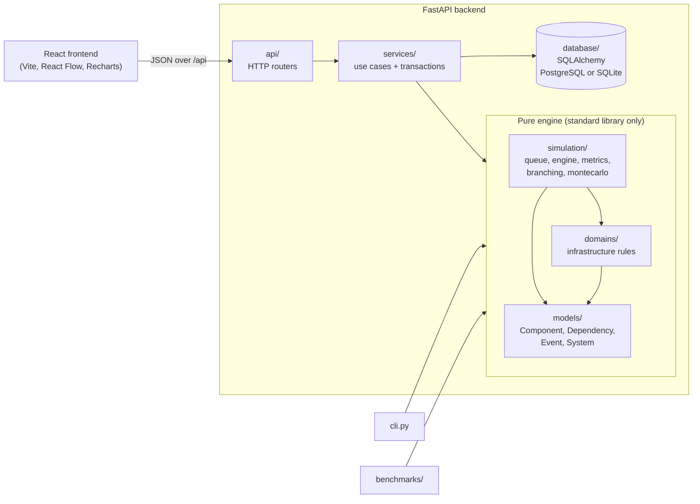
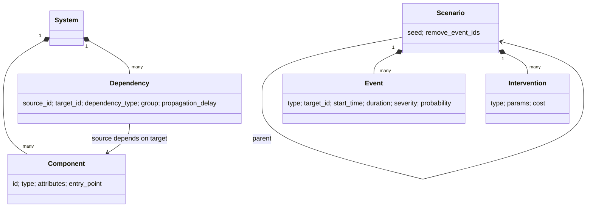
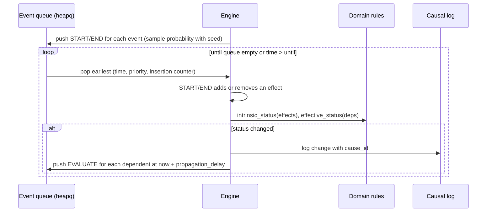

# Branchpoint architecture

This document explains how Branchpoint is put together: the layers, how a
simulation runs, how results are stored and reproduced, and the main design
decisions with their trade-offs. Read the README first for what the tool does.

## 1. The big picture



The arrows show which layer is allowed to import which. The rule that matters
most: **`simulation/`, `domains/` and `models/` never import FastAPI or
SQLAlchemy.** The engine runs the same from a Python script, the CLI, the
benchmarks or the API, and its tests need no database or server.

| Layer | Knows about | Does not know about |
|---|---|---|
| `models/` | what a component, dependency, event and system are; structural validation | time, rules, storage |
| `domains/` | what a status *means* for software infrastructure (failures, latency, load, groups) | time, queues, storage |
| `simulation/` | time, the event queue, effects, the causal log, metrics, branching, Monte Carlo | HTTP, SQL, what "infrastructure" means |
| `services/` | use cases: create, validate, run, replay, compare; database transactions | HTTP details |
| `api/` | HTTP: routes, status codes, request/response models | business rules |

Errors cross the layers in one direction. Services raise `NotFound`, `Conflict`
or `InvalidInput`; one handler in `main.py` turns them into 404, 409 and 422.

## 2. The domain model



- **Direction:** `source_id` depends on `target_id`. When the target breaks, the
  effect flows to the source. The engine therefore keeps two adjacency maps
  (`depends_on` and `dependents`) in `DependencyGraph`.
- **Groups** make redundancy work: dependencies on one source that share a
  `group` are interchangeable, so the source needs only one healthy member.
  A replica or fallback that is not in the same group as the primary has no effect.
- **Status** is an `IntEnum` (HEALTHY 0, DEGRADED 1, FAILED 2), so "the worse of
  two statuses" is simply `max()`.

## 3. How one simulation runs



1. Each event becomes a START item (and an END item if it has a duration).
   Events with `probability < 1` are sampled with `random.Random(seed)`, after
   sorting by `(start_time, id)` so the input order cannot change the result.
2. The queue orders items by `(time, priority, insertion counter)`. At equal
   times END comes before START before EVALUATE, and the counter breaks any
   remaining tie. Nothing depends on dictionary or hash order, so a run is
   fully deterministic.
3. Evaluating a component asks the domain rules for its own status (from its
   effects) and then its effective status (combined with its dependencies).
4. A change is logged with `cause_id` pointing at the log entry that caused it,
   and every dependent is scheduled for re-evaluation. That chain of pointers
   is what powers "why did this happen?" in the UI and `--explain` in the CLI.

A `max_steps` guard stops runs that oscillate (possible with cycles).

**Metrics** are computed afterwards from the status timelines, measured at the
entry-point components: availability, downtime, degraded time, affected
components, recovery time and intervention cost.

## 4. Scenarios, branching and reproducibility

A scenario inherits its parent's events and interventions; it can override an
event by reusing its id, or drop one with `remove_events`. To run a scenario,
`run_scenario` resolves the inheritance chain, **deep-copies** the base system,
applies the interventions to the copy, and simulates the copy. Branches can
never affect each other or the saved system.

Every stored run keeps:

- `system_snapshot`: the base system exactly as it was,
- `scenario_snapshot`: the resolved events and interventions, and the seed,
- the metrics, timelines and the full causal log.

`POST /runs/{id}/replay` rebuilds the simulation from those snapshots and checks
that metrics and log are identical. Because of the deterministic queue and the
seeded RNG, they always are, even after the system has been edited since.

## 5. Monte Carlo (Week 9)

`simulation/montecarlo.py` adds one pure function:

```python
run_monte_carlo(system, scenario, until, runs, base_seed=None) -> MonteCarloResult
```

Run *i* is `run_scenario` with seed `base_seed + i` (base seed defaults to the
scenario's own seed, so run 0 matches a normal single run). It returns each
run's metrics and which events happened, plus aggregates: mean, p50, p95 and
max downtime, the fraction of runs with any downtime, mean availability and
degraded time, and the frequency of each event.

Storage is deliberately a **summary**, not 1,000 runs. The `monte_carlo_runs`
table holds the aggregates and one downtime number per run (enough to draw the
histogram) in a JSONB column, plus the resolved scenario. Any individual run
can be recreated by simulating with seed `base_seed + i`, so nothing is lost
by not storing every log.

Decisions worth knowing:

- **Percentiles** use linear interpolation between sorted values (numpy's default),
  implemented by hand to keep the engine dependency-free.
- **Runs are sequential.** It keeps the code simple and the output order
  stable. Parallelising with `multiprocessing` would be straightforward because
  runs are independent, but it is not needed at current sizes (see benchmarks).
- **The UI always says "model estimates"**, because the numbers are only as good
  as the rules and the probabilities the user typed in.

## 6. Persistence

SQLAlchemy 2 ORM, PostgreSQL 16 in Docker and a SQLite file otherwise. Flexible,
domain-specific data (component attributes, intervention params, metrics,
snapshots, Monte Carlo summaries) goes in JSON columns, which become JSONB on
PostgreSQL. Relational columns hold ids, ownership and anything filtered on.

User-facing ids such as `"postgres"` are stored as `key`, unique within their
parent, and every row also has a surrogate primary key. Scenarios reference
their parent with `ON DELETE RESTRICT`, so a parent cannot be deleted while it
has branches. Tables are created with `create_all` on startup; Alembic
migrations are a known gap.

## 7. Frontend

React 18 + TypeScript, no UI framework (colours are CSS variables in
`styles.css`).

- `src/api/types.ts` mirrors `backend/app/schemas.py` by hand; the two are
  updated together.
- Pure logic lives in `src/lib/` (layout, timelines, presets, histogram) and is
  unit-tested with vitest. Components stay thin.
- The Design tab edits a local draft; scenarios always run against the saved
  system, and the UI warns when there are unsaved changes.
- `MonteCarloPanel` (scenario page) and the Compare page call the Monte Carlo
  endpoint. Compare runs batches one scenario at a time so a local SQLite file
  is never written to concurrently.

In production one FastAPI process serves both the API and the built frontend
(`frontend/dist`), which is what the multi-stage Dockerfile builds.

## 8. Testing

| Suite | What it covers |
|---|---|
| `test_graph.py` | BFS blast radius, DFS cycle detection, topological order |
| `test_engine.py` | small hand-checkable propagation cases: chains, delays, optional, groups, fallbacks, spikes, explain |
| `test_branching.py` | inheritance, overrides, interventions on copies |
| `test_montecarlo.py` | percentiles, identical runs for deterministic scenarios, a p = 0.5 event over 1,000 runs, same base seed gives the same aggregates |
| `test_api.py` | the full HTTP workflow, validation errors, replay, compare, Monte Carlo endpoints |
| `lib.test.ts` | frontend pure logic |
| `e2e/smoke.mjs` | the whole app in a real browser, including Monte Carlo |

API tests run on in-memory SQLite by default and on PostgreSQL when
`TEST_DATABASE_URL` is set.

## 9. Performance

See the Benchmarks section of the README and `benchmarks/run_benchmarks.py`.
In short: runtime grows about linearly with the number of components and edges
(a 10,000-component chain takes ~100 ms, a 10,000-component DAG with ~30,000
edges ~0.5 s), and the cost is driven by status changes rather than raw event
count. Profiling shows most time is spent combining dependency statuses in
`InfrastructureRules.effective_status`, so that is where optimisation would start.

## 10. Known limitations

Rule-based model, not a reliability predictor; traffic spikes do not propagate
load downstream; hard circular dependencies cannot recover; no migrations, no
authentication; the Docker build has not been verified on a real machine; no
frontend component tests beyond `lib/` and the e2e script.
